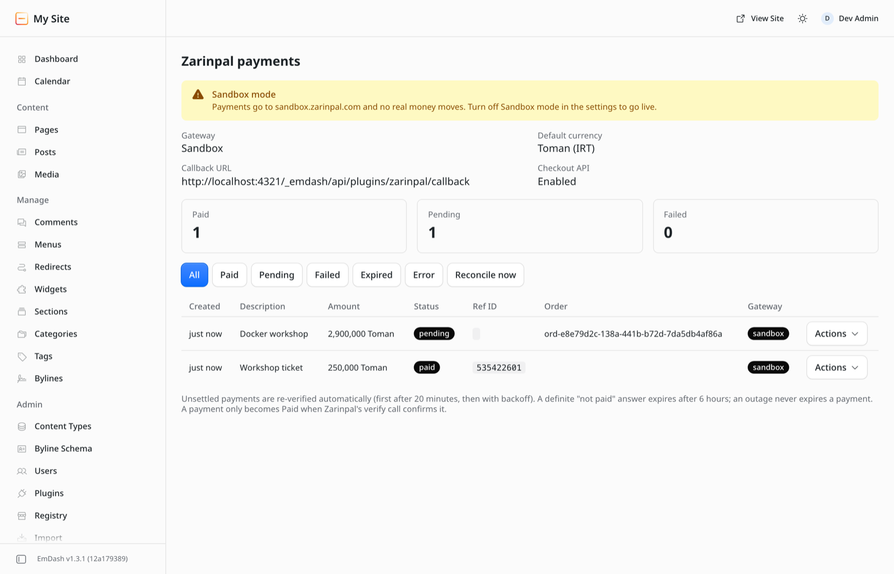
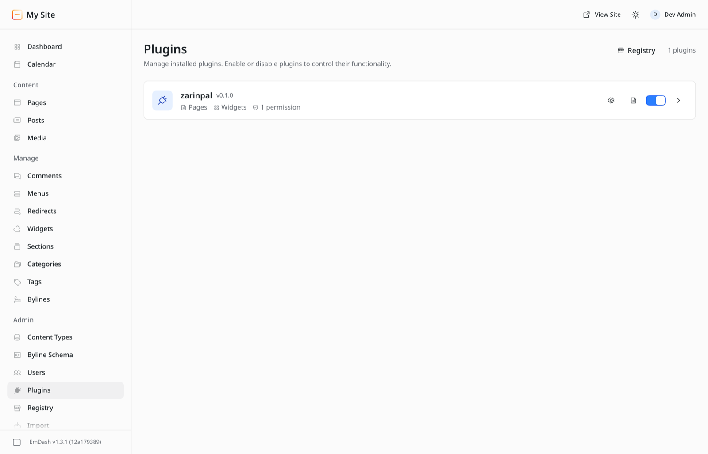
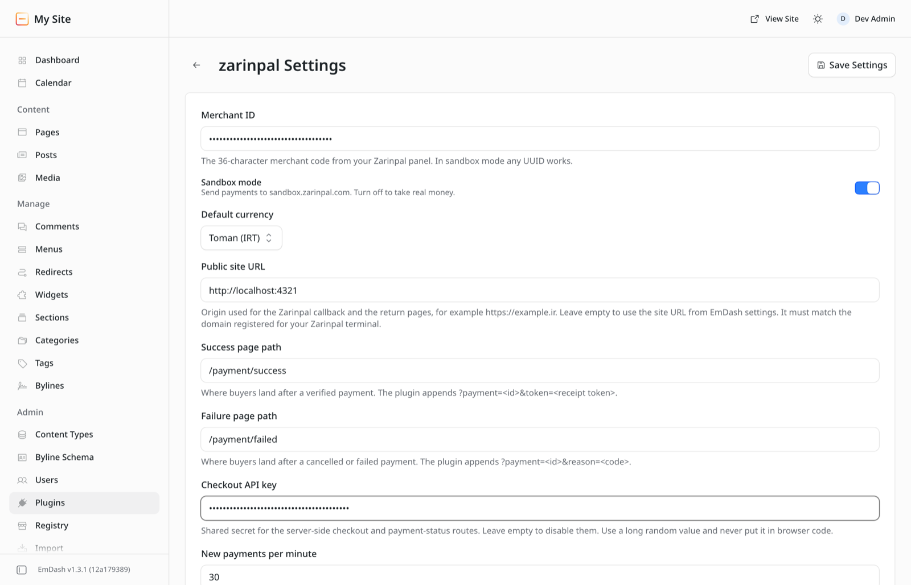
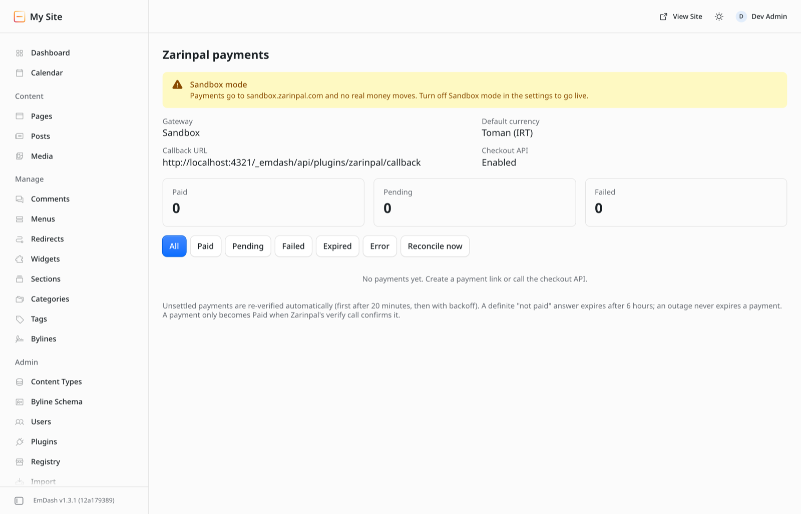
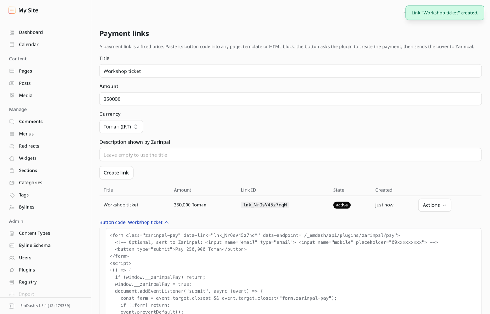
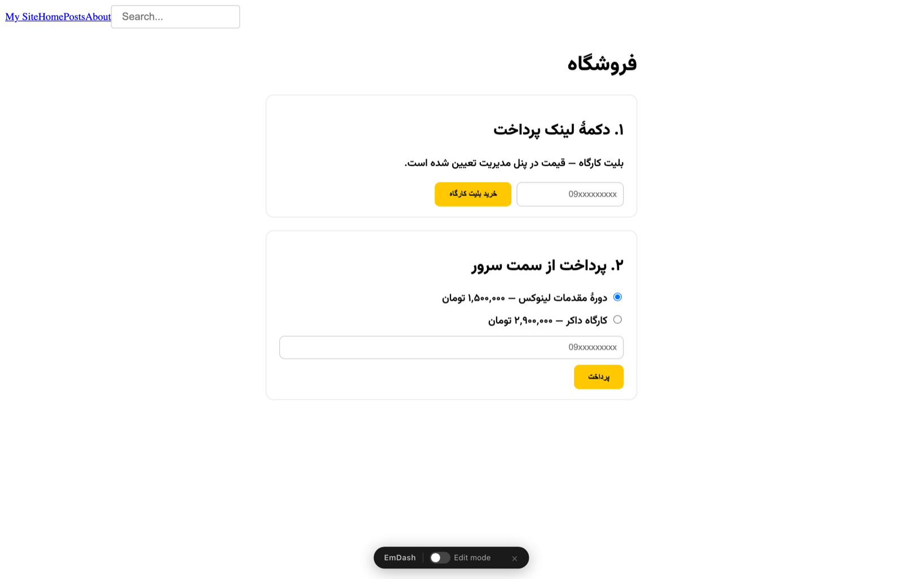
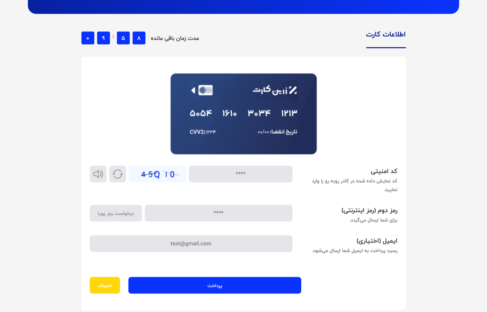
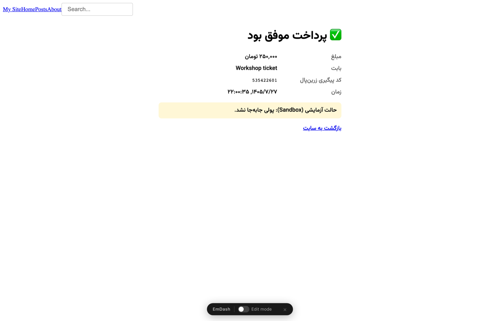
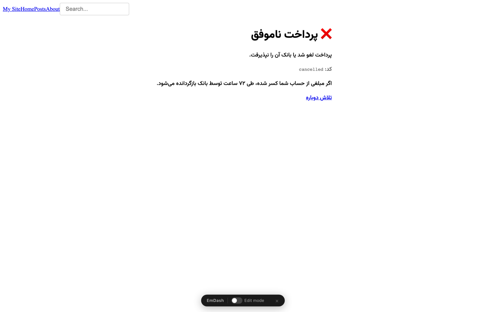
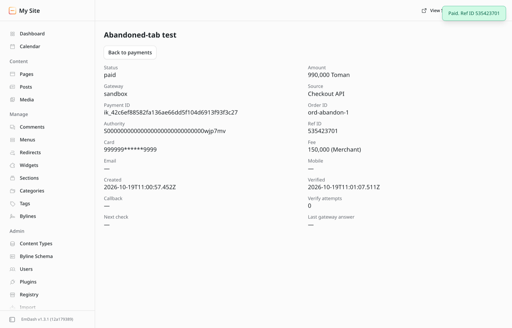

# Zarinpal for EmDash

Accept Iranian Rial and Toman payments on an [EmDash CMS](https://emdashcms.com) site through the [Zarinpal](https://www.zarinpal.com) gateway. Built for EmDash on **Cloudflare Workers**, and it also runs on Node.js.

[راهنمای فارسی ↓](#راهنمای-فارسی)



- **Payment links.** Create a fixed-price link in the admin, paste its button on any page, and take payments without writing server code.
- **Server-side checkout API.** Your own code sets the price and the order ID, then sends the buyer to Zarinpal.
- **Verified callbacks.** A payment becomes *paid* only when Zarinpal's verify call confirms it. The `Status=OK` in the return URL is never trusted.
- **Automatic reconciliation.** A cron job re-verifies unsettled payments in the background, so a buyer who paid and closed the tab is not lost. An outage never makes the plugin give up on a payment.
- **Admin ledger.** Filter payments, see Zarinpal reference IDs, card masks and fees, re-verify one payment, and watch a dashboard widget.
- **Sandboxed and least-privilege.** It runs in EmDash's plugin sandbox and can only reach `payment.zarinpal.com` and `sandbox.zarinpal.com`. It cannot read your content, media or users.

Tested against the live Zarinpal sandbox on 19 October 2026 with EmDash 1.3.1. See [Testing](#testing).

## Contents

- [How a payment works](#how-a-payment-works)
- [Requirements](#requirements)
- [Install on Cloudflare Workers](#install-on-cloudflare-workers)
- [Install on Node.js](#install-on-nodejs)
- [Configure the plugin](#configure-the-plugin)
- [Take payments with a payment link](#take-payments-with-a-payment-link)
- [Take payments from your own code](#take-payments-from-your-own-code)
- [Fulfil orders safely](#fulfil-orders-safely)
- [Go live](#go-live)
- [Route reference](#route-reference)
- [Payment states and reconciliation](#payment-states-and-reconciliation)
- [Security](#security)
- [Known limitations](#known-limitations)
- [Testing](#testing)
- [Development](#development)
- [راهنمای فارسی](#راهنمای-فارسی)

## How a payment works

```text
Buyer          Your site (EmDash + plugin)            Zarinpal
  │  click Pay  ─────►  create payment record
  │                     POST request.json  ─────────►  authority
  │  ◄─────────────────  StartPay URL
  │  pay at the bank  ──────────────────────────────►
  │  ◄────────────────────────────────  redirect to /callback?Authority=…&Status=…
  │                     POST verify.json  ──────────►  100 / 101 + ref_id
  │  ◄─────────────────  303 to /payment/success?payment=…&token=…
```

1. The plugin stores the payment first, then asks Zarinpal for an *authority*.
2. The buyer pays on Zarinpal's page. Zarinpal sends them back to the plugin's callback route.
3. The callback calls Zarinpal's `verify` with the amount and currency stored on the payment. Only a `100` or `101` answer marks it paid.
4. The buyer lands on your success page with a receipt token. Your server asks the plugin for the authoritative status before fulfilling the order.

## Requirements

| What | Why |
| --- | --- |
| EmDash **1.3** or newer | The plugin uses the 1.3 sandbox route contract. |
| A sandbox runner | On Cloudflare this is Worker Loader, which needs the **Workers Paid** plan. On Node.js it is `@emdash-cms/sandbox-workerd`. |
| `EMDASH_ENCRYPTION_KEY` | The merchant ID and API key are encrypted settings. |
| A Zarinpal merchant ID | Any UUID works in sandbox mode. For live payments the terminal's registered domain must match your site, or Zarinpal answers `-14`. |

## Install on Cloudflare Workers

These steps assume a site created from an EmDash `*-cloudflare` template, which already has a `src/worker.ts`.

### 1. Enable sandboxed plugins

Worker Loader needs the [Workers Paid plan](https://developers.cloudflare.com/dynamic-workers/pricing/). If you created the site with `--sandboxed-plugins`, this step is already done.

Uncomment the binding in `wrangler.jsonc`:

```jsonc
{
	"worker_loaders": [{ "binding": "LOADER" }]
}
```

Check that `src/worker.ts` exports `PluginBridge` and the scheduled handler. The reconciliation job needs the scheduled handler and the template's cron trigger:

```ts
import handler, { createScheduledHandler, PluginBridge } from "@emdash-cms/cloudflare/worker";

export { PluginBridge };

export default {
	...handler,
	scheduled: createScheduledHandler(),
} satisfies ExportedHandler;
```

### 2. Add the plugin

```sh
pnpm add github:taleghanidev/emdash-plugin-zarinpal
```

The built files in `dist/` are committed, so no build step runs on install. Pin a release with `github:taleghanidev/emdash-plugin-zarinpal#v0.1.0`.

### 3. Register it in `astro.config.mjs`

```js
import cloudflare from "@astrojs/cloudflare";
import react from "@astrojs/react";
import { d1, r2, sandbox } from "@emdash-cms/cloudflare";
import { defineConfig } from "astro/config";
import emdash from "emdash/astro";
import zarinpal from "emdash-plugin-zarinpal";

export default defineConfig({
	output: "server",
	adapter: cloudflare(),
	integrations: [
		react(),
		emdash({
			database: d1({ binding: "DB", session: "auto", coalesce: true }),
			storage: r2({ binding: "MEDIA" }),
			sandboxRunner: sandbox(),
			sandboxed: [zarinpal],
		}),
	],
});
```

### 4. Set the secrets

```sh
# Encrypts plugin secrets. Keep a copy outside Cloudflare: without it the
# stored merchant ID and API key cannot be decrypted.
npx emdash secrets generate
npx wrangler secret put EMDASH_ENCRYPTION_KEY

# Only if you use the server-side checkout. Use the same value as the
# plugin's "Checkout API key" setting.
openssl rand -base64 32
npx wrangler secret put ZARINPAL_API_KEY
```

For local development put the same names in `.dev.vars`.

### 5. Add the return pages

Copy the example files into your site. They use the template's `src/layouts/Base.astro`; change that import if your layout lives elsewhere.

| Copy from `examples/astro/src/` | Purpose |
| --- | --- |
| `lib/zarinpal.ts` | Calls plugin routes in-process from Astro code |
| `pages/payment/success.astro` | Receipt page after a verified payment |
| `pages/payment/failed.astro` | Page after a cancelled or failed payment |
| `components/ZarinpalButton.astro` | Pay button for a payment link |
| `pages/api/checkout.ts` | Optional server-side checkout endpoint |
| `pages/shop.astro` | Optional demo page with both payment methods |

```sh
cp -R node_modules/emdash-plugin-zarinpal/examples/astro/src/* src/
```

### 6. Deploy

```sh
pnpm run deploy
```

Open the admin, go to **Plugins**, and continue with [Configure the plugin](#configure-the-plugin).

## Install on Node.js

```sh
pnpm add github:taleghanidev/emdash-plugin-zarinpal @emdash-cms/sandbox-workerd workerd
```

```js
import node from "@astrojs/node";
import react from "@astrojs/react";
import { defineConfig } from "astro/config";
import emdash, { local } from "emdash/astro";
import { sqlite } from "emdash/db";
import zarinpal from "emdash-plugin-zarinpal";

export default defineConfig({
	output: "server",
	adapter: node({ mode: "standalone" }),
	integrations: [
		react(),
		emdash({
			database: sqlite({ url: "file:./data.db" }),
			storage: local({ directory: "./uploads", baseUrl: "/_emdash/api/media/file" }),
			sandboxRunner: "@emdash-cms/sandbox-workerd/sandbox",
			sandboxed: [zarinpal],
		}),
	],
});
```

Set `EMDASH_ENCRYPTION_KEY` and, if you use checkout, `ZARINPAL_API_KEY` in the server's environment. Copy the example pages as in step 5 above.

## Configure the plugin

Open **Plugins**, then the gear icon on **zarinpal**.





| Setting | What to enter |
| --- | --- |
| Merchant ID | Your 36-character merchant code. In sandbox mode any UUID works, for example `1344b5d4-0048-11e8-94db-005056a205be`. |
| Sandbox mode | On while you test. No real money moves. |
| Default currency | Toman (IRT) or Rial (IRR). It applies to links and checkout calls that do not name a currency. |
| Public site URL | Your site's origin, such as `https://example.ir`. Leave it empty to use the URL from EmDash's settings. The callback URL is built from it. |
| Success / Failure page path | Default `/payment/success` and `/payment/failed`. Paths only, on your own site. |
| Checkout API key | A long random secret for the server routes. Leave empty to disable them. |
| New payments per minute | A site-wide cap on new payment attempts. Default 30. |

The **Zarinpal payments** page shows the callback URL the plugin sends to Zarinpal, so you can check it before going live.



## Take payments with a payment link

1. Open **Payment links**, enter a title and an amount, and select **Create link**.
2. Expand **Button code** and copy it into a page, a template or an HTML block. In Astro you can use the bundled component instead:

   ```astro
   ---
   import ZarinpalButton from "../components/ZarinpalButton.astro";
   ---
   <ZarinpalButton link="lnk_GMloPG1ukBXd" label="خرید بلیت" askMobile />
   ```



The button posts the link ID to the plugin. The plugin takes the price from the link, never from the browser, and returns Zarinpal's payment URL. The script only navigates to a `payment.zarinpal.com` or `sandbox.zarinpal.com` address.

| Shop page | Zarinpal sandbox | Receipt |
| --- | --- | --- |
|  |  |  |

Disabling or deleting a link stops new payments. Its past payments stay in the ledger.

## Take payments from your own code

Use this when the price depends on a cart, a coupon or a logged-in user. Your server code calls the plugin's `checkout` route in-process through `Astro.locals.emdash`. On Cloudflare this matters, because a Worker that fetches its own hostname is not reliable.

```ts
// src/pages/api/checkout.ts (full version in examples/)
import type { APIRoute } from "astro";
import { zarinpal } from "../../lib/zarinpal";

export const POST: APIRoute = async ({ request, locals, url, redirect }) => {
	const form = await request.formData();
	const product = PRODUCTS[String(form.get("product"))]; // your own price list
	const orderId = `ord-${crypto.randomUUID()}`;

	const result = await zarinpal(locals, url, "checkout", {
		body: {
			apiKey: process.env.ZARINPAL_API_KEY,
			amount: product.amount, // whole number, in `currency`
			currency: "IRT",
			description: product.title,
			orderId,
			idempotencyKey: orderId, // retrying with the same key never creates a second payment
		},
	});
	if (!result.ok) return redirect(`/payment/failed?reason=${result.data.error}`, 303);
	return redirect(result.data.paymentUrl, 303);
};
```

On Cloudflare, `process.env` holds Worker secrets when `nodejs_compat` is on and the compatibility date is 2025-04-01 or later. The EmDash templates meet both conditions.



## Fulfil orders safely

Never fulfil because the buyer reached the success page or because a URL says `Status=OK`. Ask the plugin, with your API key, and check the facts that matter to you:

```ts
const res = await zarinpal(locals, url, "payment", {
	body: { apiKey: process.env.ZARINPAL_API_KEY, orderId, verify: true },
});
const p = res.data.payment;
if (p?.paid && p.amount === expectedAmount && p.currency === "IRT" && p.environment === "production") {
	await markOrderPaidOnce(orderId, p.refId); // make this idempotent in your database
}
```

`verify: true` re-verifies up to two unsettled attempts with Zarinpal before answering, which is useful when the buyer never came back. When an order has several attempts, a paid one is returned first, and `attempts` lists them all.

## Go live

1. Register your domain on your Zarinpal terminal. Its domain must match **Public site URL**.
2. Enter the real Merchant ID and turn off **Sandbox mode**.
3. Make one small real payment and check the ledger shows **paid** with a reference ID.
4. Make sure your fulfilment code checks `environment === "production"`, so a sandbox payment never ships an order.

Payments keep the environment they were created in. Switching modes does not move old sandbox payments to production.

## Route reference

All routes live under `/_emdash/api/plugins/zarinpal/`. JSON routes answer inside EmDash's envelope: `{ "success": true, "data": { … } }`. Errors are `data.ok === false` with an `error` code.

| Route | Method | Auth | Purpose |
| --- | --- | --- | --- |
| `pay` | POST JSON | public | Start a payment from a payment link. Body `{ link, email?, mobile? }`. Returns `{ ok, paymentId, paymentUrl }`. |
| `checkout` | POST JSON | API key in body | Start a payment from server code. Body `{ apiKey, amount, description, currency?, orderId?, idempotencyKey?, email?, mobile? }`. Returns `{ ok, paymentId, authority, paymentUrl, reused, environment }`. |
| `callback` | GET | public | Zarinpal's return URL. Verifies, then redirects with 303 to your success or failure path. |
| `receipt` | GET | receipt token | `?payment=&token=` from the success redirect. Returns display fields only. |
| `payment` | POST JSON | API key in body | Authoritative status for fulfilment. Body `{ apiKey, paymentId }` or `{ apiKey, orderId }`, plus optional `verify: true`. |
| `admin` | POST | EmDash admin | Block Kit pages and widget. |

Checkout and payment error codes:

| Code | Meaning |
| --- | --- |
| `CHECKOUT_DISABLED` | No Checkout API key is set. |
| `UNAUTHORIZED` | Wrong API key. |
| `NOT_CONFIGURED`, `NO_SITE_URL` | Merchant ID or site URL missing. |
| `INVALID_AMOUNT` | Not a positive whole number, or above Zarinpal's limit of 100,000,000 Toman. |
| `INVALID_CURRENCY` | `currency` was given but is not exactly `IRR` or `IRT`. |
| `INVALID_DESCRIPTION` | Empty or over 500 characters. |
| `INVALID_ORDER_ID` | Use 1 to 64 of `A-Z a-z 0-9 . _ : -`. |
| `IDEMPOTENCY_CONFLICT` | The key was used with a different amount, order or customer. |
| `IN_PROGRESS` | Another request with the same key is starting this payment. Retry after a minute. |
| `ALREADY_PAID`, `PAYMENT_NOT_PAYABLE` | The key's payment is settled. Use a new key for a new attempt. |
| `RATE_LIMITED` | The per-minute cap was reached. |
| `GATEWAY_REJECTED` | Zarinpal refused the request. The ledger shows its code, for example `-14` for a domain mismatch. |
| `UNKNOWN_LINK` | The payment link does not exist or is disabled. |

Failure redirect reasons: `cancelled`, `verify_pending` (Zarinpal could not be reached; reconciliation retries), `zarinpal_<code>` such as `zarinpal_-51`, `unknown_payment`, `invalid_callback`.

## Payment states and reconciliation

| State | Meaning | Final? |
| --- | --- | --- |
| `pending` | Created; the buyer has not come back or verification has not run. | No |
| `paid` | Zarinpal's verify returned `100` or `101`. | Yes |
| `failed` | The last verify said not paid (`-51` or `-54`). | No: a later verify can still find it paid |
| `expired` | Zarinpal still said not paid 6 hours after the authority was issued. | Only until a callback or **Verify now** finds it paid |
| `error` | Zarinpal refused to create it, so it has no authority. | Yes |

Rules the plugin keeps:

- Only a successful verify writes `paid`, and every write is guarded by the current state. A forged or repeated callback cannot downgrade a paid payment.
- `Status=NOK` is recorded as an observation and the buyer goes to the failure page, but the payment stays open for reconciliation.
- Verify always uses the amount and currency stored on the payment. In the sandbox, an IRT payment verified with the Rial amount fails with `-50`, so mixing units is never allowed.
- Only Zarinpal's "not paid" answers, `-51` and `-54`, can fail or expire a payment. A network error, a rate limit such as `-12`, or any other code keeps the payment scheduled, at least every 3 hours, without end.
- Each payment remembers a fingerprint of the merchant ID that created it. If you change the merchant ID, older open payments are not verified against the new one, since Zarinpal would answer `-53`. They stay open with a note in the ledger until you restore the old ID.
- The cron job runs every minute and checks at most 3 due payments per run, oldest first, which is about 180 checks an hour. Each payment is checked about 20 minutes, 2 hours and 6 hours after its authority was issued.



Use **Actions → Verify now** on any unsettled row to check one payment immediately, or **Reconcile now** to process due payments.

## Security

- **Least privilege.** The only capability is `network:request`, limited to Zarinpal's two hosts.
- **Secrets.** The merchant ID and API key are stored encrypted with `EMDASH_ENCRYPTION_KEY`. Keep the API key on the server. Never put it in browser code.
- **Prices.** Payment links take the price from the stored link. Checkout takes it from your server code. The browser never sets an amount.
- **No open redirects.** Return pages are paths on your own site. EmDash also blocks public plugin routes from redirecting to another origin.
- **Receipts.** The success URL carries a random receipt token, and the `receipt` route returns only display fields.
- **Abuse.** Payment creation is POST-only, so crawlers and link previews never create payments, and a per-minute cap protects your Zarinpal terminal from error `-12`.

## Known limitations

- **Local `astro dev` with the Cloudflare adapter cannot reach Zarinpal.** The local workerd runtime fails the TLS connection to Zarinpal's ArvanCloud edge with `internal error`, for any Worker, not only this plugin. A deployed Worker reaches both Zarinpal hosts normally. For local end-to-end tests use the Node.js setup above, or test on a deployed preview.
- **Cloudflare limits per plugin call:** 10 subrequests and 50 ms CPU. Each route stays within them, which is why reconciliation handles 3 payments per run. With three checks per payment that covers about 60 abandoned payments an hour. Above that, checks queue up in order but are never dropped.
- **Display name.** EmDash shows config-installed plugins by their ID, so the admin says *zarinpal*.
- **Registry.** The plugin is not yet published to the EmDash registry. Install it from GitHub as shown above.

## Testing

```sh
pnpm install
pnpm test          # manifest validation + 31 tests through EmDash's Cloudflare sandbox runner
pnpm run typecheck
```

The tests use `@emdash-cms/plugin-test`, which loads the built plugin through EmDash's production Worker Loader wrapper with mocked Zarinpal responses. They cover idempotency and restarts, forged `NOK` callbacks, `-51` followed by a later payment, gateway outages, merchant ID changes, orders with several attempts, rate limits, link payments and the admin pages.

End-to-end runs use Playwright against the real `sandbox.zarinpal.com` and a real EmDash site. The scripts are in `e2e/`:

```sh
cd e2e && npm install && npx playwright install chromium
node e2e.mjs ../docs/screenshots /path/to/site/.env      # links, checkout, cancel, ledger, screenshots
node abandon.mjs ../docs/screenshots /path/to/site/.env  # buyer pays and never returns; admin recovers
```

The screenshots in this README come from those runs.

## Development

```sh
pnpm run dev       # rebuild on change
pnpm run build     # writes dist/ (commit it: GitHub installs use it)
```

Source layout:

| File | Role |
| --- | --- |
| `src/zarinpal.ts` | Zarinpal v4 client: request, verify, error codes |
| `src/payments.ts` | Settings, payment records, creation, verification, rate limit |
| `src/plugin.ts` | Public routes, cron hook |
| `src/admin.ts` | Block Kit admin pages and widget |
| `src/reconcile.ts` | Reconciliation job |
| `src/snippet.ts` | Payment-link button HTML |
| `emdash-plugin.jsonc` | Capabilities, allowed hosts, storage, settings schema |

Before publishing to the EmDash registry, replace `publisher` in `emdash-plugin.jsonc` with your own Atmosphere DID and run `pnpm run publish`.

## راهنمای فارسی

این افزونه درگاه زرین‌پال را به سایت‌های EmDash روی Cloudflare Workers یا Node.js اضافه می‌کند.

**نصب روی Cloudflare**

۱. در `wrangler.jsonc` اتصال `worker_loaders` با نام `LOADER` را فعال کنید (پلن پولی Workers لازم است).

۲. افزونه را نصب کنید:

```sh
pnpm add github:taleghanidev/emdash-plugin-zarinpal
```

۳. در `astro.config.mjs` بنویسید `sandboxRunner: sandbox()` و `sandboxed: [zarinpal]`.

۴. کلید رمزنگاری و در صورت نیاز کلید API را بسازید و با `wrangler secret put` ذخیره کنید.

۵. صفحه‌های نمونهٔ پوشهٔ `examples/astro` را در سایت کپی و سایت را مستقر کنید.

**تنظیم**

در پنل مدیریت به Plugins و سپس تنظیمات zarinpal بروید. مرچنت‌کد را وارد کنید. در حالت Sandbox هر UUID قابل قبول است. نشانی سایت را بنویسید؛ دامنه باید با دامنهٔ ثبت‌شده در زرین‌پال یکی باشد.

**دریافت پول**

- **لینک پرداخت:** در صفحهٔ Payment links مبلغ را تعیین کنید و کد دکمه را در صفحه بگذارید.
- **پرداخت از سمت سرور:** کد سایت شما مبلغ را تعیین می‌کند و مسیر `checkout` را با کلید API صدا می‌زند.

**نکته‌های مهم**

- پرداخت فقط وقتی «پرداخت‌شده» می‌شود که متد verify زرین‌پال آن را تأیید کند. پارامتر `Status=OK` در نشانی بازگشت هیچ‌وقت ملاک نیست.
- اگر خریدار پرداخت کند و به سایت برنگردد، افزونه پرداخت را در پس‌زمینه دوباره بررسی می‌کند. قطعی ارتباط با زرین‌پال هیچ پرداختی را از بین نمی‌برد. از صفحهٔ پرداخت‌ها هم می‌توانید «Verify now» را بزنید.
- برای تحویل سفارش، وضعیت را از مسیر `payment` با کلید API بپرسید و مبلغ و محیط (`production`) را بررسی کنید.
- مبلغ تأیید باید با همان واحدی باشد که پرداخت با آن ساخته شده است (تومان یا ریال). افزونه این را خودکار رعایت می‌کند.

## License

MIT © Mehdi Taleghani
